The code for the following article is available on this repo <a target="_blank" href="https://github.com/sebgra/intelligent_antibodies">
  
</a>

<div style="text-align: center;">
  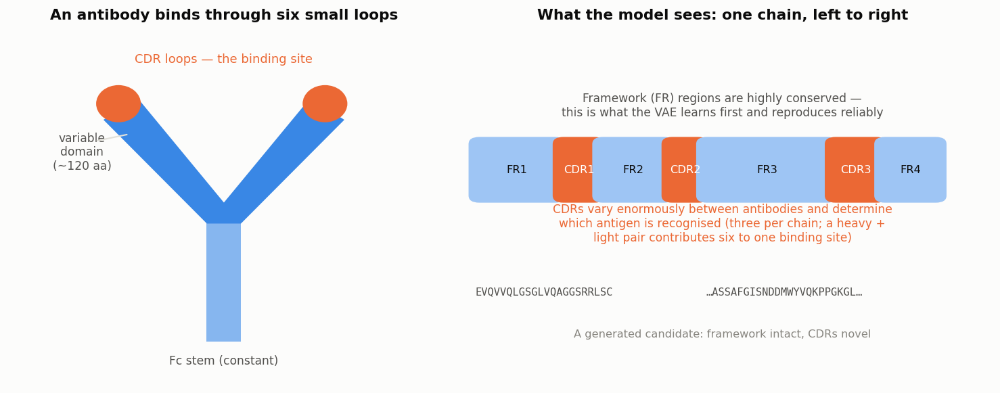
  <p>An antibody, and the same antibody as a model sees it</p>
</div>

**Can we ask a neural network to invent a protein that has never existed?**

In the [first](/posts/2023/06/blog-post-1/) and [second](/posts/2024/02/blog-post-2/) articles of this series, we asked a network to **recognise** something: is this DNA sequence a promoter or not? That is a classification problem, and classification is, in a sense, the easy direction. The network looks at an object and attaches a label to it.

Today we turn the arrow around. Rather than labelling an existing sequence, we'll try to **produce a new one** — an amino acid sequence that never existed, but that resembles a real antibody closely enough to be worth a second look. And since "resembles an antibody" is not something anyone can check by eye on a few hundred residues, we'll build a second network whose job is to judge the first one's output.

A word of caution before rolling up our sleeves. This project is a **draft, an experiment, a toy** — something assembled over a few evenings to see whether the idea holds together at all. Real antibody design today relies on protein language models trained on hundreds of millions of sequences, on diffusion models working directly in three dimensions, and on experimental validation at every step. We'll come back to this at the end. What follows is not how a therapeutic antibody is designed; it is how you can get a feel for generative models applied to biological sequences, with real data and real biology underneath.

---

## Why antibodies?

Before any code, a little immunology — the choice of molecule is not arbitrary, and the biology will explain most of our later design decisions.

An **antibody** (or immunoglobulin) is a protein produced by the immune system to recognise a specific target, called the **antigen**. Its shape is the famous Y. Each antibody is assembled from two kinds of chain, a **heavy chain** and a **light chain**, which pair up. The stem of the Y is constant and structural; the tips of the two arms are where recognition happens.

Within each arm sits the **variable domain**, roughly 110 to 130 residues long. And within that domain, three short loops do nearly all the work: the **CDRs**, for *Complementarity-Determining Regions*. One heavy chain and one light chain together contribute six CDR loops to a single binding site. Everything around them — the **framework** regions — is a scaffold holding those loops in place.

This gives antibodies a property that is unusual, and very convenient for us:

- the **framework is nearly identical** from one antibody to the next, because it is a conserved structural unit;
- the **CDRs vary enormously**, because that variation is precisely how the immune system covers an unpredictable world of antigens.

Put differently, an antibody sequence is **mostly predictable, with a few highly unpredictable stretches**. For a generative model this is an excellent playground: there is a strong statistical regularity to learn, and genuine diversity to produce. Had we picked an arbitrary protein family, the model would have had far less structure to hold on to.

---

## Defining the Problem

Our problem splits into two tasks, and therefore into two networks.

1. **Generate** a plausible antibody sequence. For this, a **variational autoencoder** (VAE), trained on real antibody chains only. It never sees an antigen.
2. **Judge** whether a candidate antibody and a given antigen would interact. For this, a **Siamese network**, trained on pairs of sequences labelled as interacting or not.

The pipeline then becomes: sample from the generator, score each candidate with the judge, keep the best ones.

<div style="text-align: center;">
  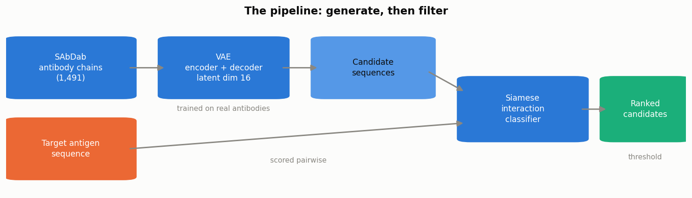
  <p>Generate, then filter</p>
</div>

Note the division of labour, which is the interesting part of the design. The generator learns **what an antibody looks like**; the judge learns **what makes a pair stick together**. Neither question can be answered by the other network, and the two can be trained entirely independently.

---

## The Data

Everything comes from **SAbDab**, the *Structural Antibody Database* maintained by the OPIG group in Oxford. It catalogues antibody structures deposited in the PDB, with their chains annotated and their antigens identified. From it we build two tables:

- `sequences.csv` — one row per chain, tagged `|ab` (antibody) or `|ag` (antigen);
- `data_filtered.csv` — one row per pair of chains, with a label: 1 if they interact, 0 otherwise.

```python
import pandas as pd

seq = pd.read_csv("data/SAbDab/sequences.csv", sep=";")
seq[["pdb", "chain_type"]] = seq["seq_id"].str.split("|", n=1, expand=True)
seq["length"] = seq["sequence"].str.len()

print(seq["chain_type"].value_counts())
print(f"Number of chains : {seq.shape[0]}")

>>> chain_type
>>> ab    1491
>>> ag    1341
>>> Name: count, dtype: int64
>>> Number of chains : 2832
```

As in any good data analysis, let's look at what we actually have before feeding anything to a network.

### How long is an antibody?

<div style="text-align: center;">
  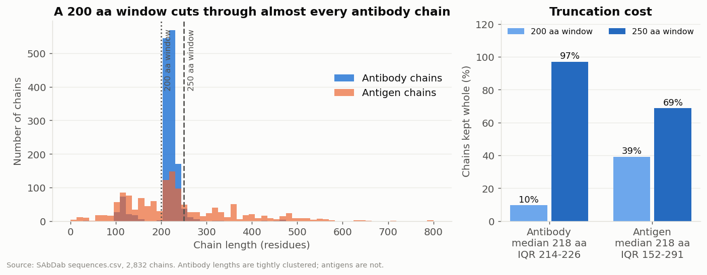
  <p>Chain length distribution, and what each encoding window preserves</p>
</div>

The two distributions could hardly be more different, and both differences are biologically meaningful.

**Antibody chains are strikingly uniform**: median 218 residues, interquartile range 214 to 226. That narrowness is the immunoglobulin fold asserting itself — it is the same structural unit every time, so it has very nearly the same length every time.

**Antigens are whatever the immune system happened to encounter**: interquartile range 152 to 291, with a tail beyond 800 residues. There is no "typical" antigen, because an antigen is simply any molecule some immune system decided to react to.

This distribution settles a hyperparameter for us. Our networks need **fixed-size inputs**, so we must choose a window length and truncate or pad every sequence to it. The coverage curve is unusually sharp: at 200 residues we keep only **10%** of antibody chains intact, and at 250 we keep **97%**. Below 250, we are cutting through the CDR3 loop — the most important one — on almost every chain.

### What are antibodies made of?

<div style="text-align: center;">
  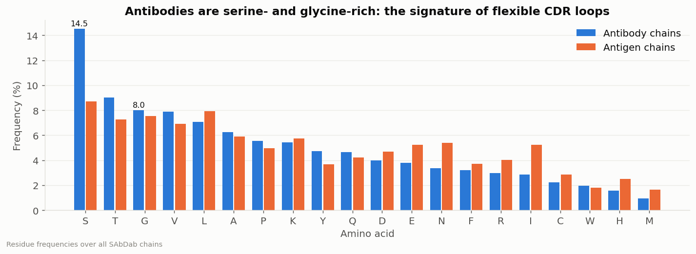
  <p>Residue frequency, antibody chains versus antigen chains</p>
</div>

Comparing the amino acid composition of the two groups gives us a small biological sanity check. Antibodies are visibly enriched in **serine** and **glycine** relative to their antigens. This is not a quirk of the database: glycine has no side chain at all, and serine only a very small one, so both grant the backbone unusual flexibility. That flexibility is exactly what a CDR loop needs in order to wrap itself around a target whose shape it cannot anticipate.

Note also the low but steady frequency of **cysteine**. Those are the disulfide bridges stapling the immunoglobulin domain together — a structural signature our generator will have to reproduce if its output is to be credible.

### One last look before encoding

<div style="text-align: center;">
  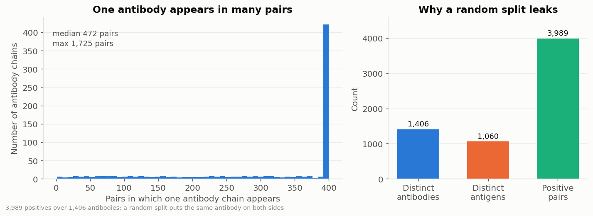
  <p>3,989 interacting pairs, spread over only 1,406 distinct antibodies</p>
</div>

A detail that matters enormously, and that is easy to miss: the **same antibody chain appears in many pairs**. We have 3,989 positive pairs, but only 1,406 distinct antibodies behind them.

Why does this matter? Because if we split our data randomly into training and test sets, **copies of the same antibody land on both sides**. The test score would then partly measure the network's ability to recognise an antibody it has already memorised — whereas our actual goal is to score antibodies that have never existed. We'll return to this when preparing the datasets.

<div style="text-align: center;">
  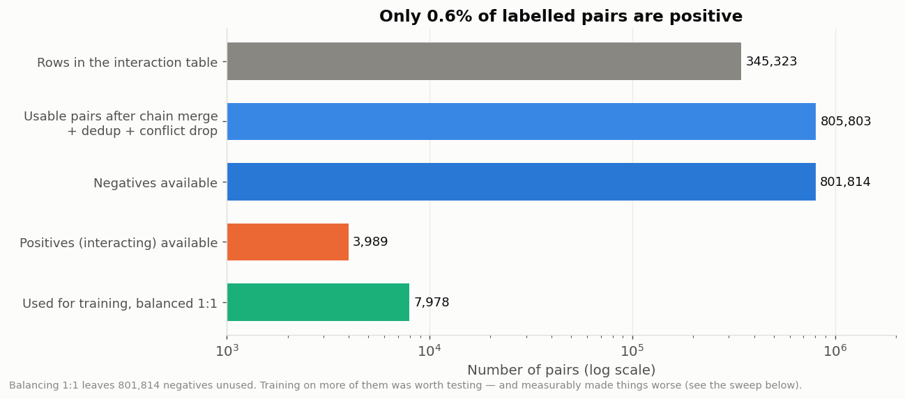
  <p>Of 805,803 usable pairs, only 3,989 are positive</p>
</div>

Finally, the labels are **extremely imbalanced**: barely 0.6% of pairs are interacting ones. This is expected — a given antibody binds its antigen and essentially nothing else, so nearly every possible pairing is a negative. We'll handle this by **balancing**: keeping all the positives, and drawing an equal number of negatives at random.

---

## From Letters to Tensors

As in the previous articles, our networks cannot read text. A sequence of amino acids must become a matrix of numbers, and the classic approach is again **one-hot encoding**.

The principle is identical to the DNA case, with one difference: instead of 4 nucleotides we have 20 amino acids. We'll use an alphabet of 22 letters — the 20 standard residues plus `X` and `U`, placeholders for unknown or unusual positions.

```python
AMINO_ACID_ALPHABET = "ARNDCQEGHILKMFPSTWYVXU"

class ProteinOneHotEncoder:

    def one_hot_encode_sequence(self, sequence: str, vector_size: int) -> np.ndarray:
        encoded = np.zeros((vector_size, len(self.encoder)))
        if len(sequence) > vector_size:
            sequence = sequence[:vector_size]
        for i, letter in enumerate(sequence):
            encoded[i] = self.encoder[letter]
        return encoded
```

Each residue therefore becomes a vector of 22 values: 21 zeros and a single 1.

```python
encoder = ProteinOneHotEncoder()
x = encoder.encode(pd.Series(["QVQLVQSGAEVKKPGSSVKISCKAS"]), vector_size=250)
print(f"Shape of one-hot encoded sequence : {x.shape}")

>>> Shape of one-hot encoded sequence : (1, 250, 22)
```

<div style="text-align: center;">
  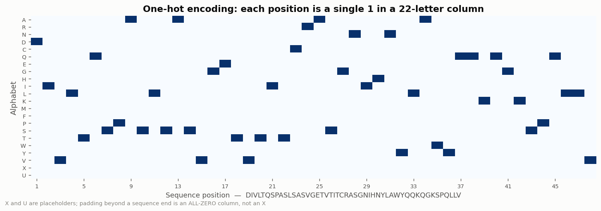
  <p>Protein sequence encoding</p>
</div>

One point deserves attention, because it will come back to bite us later. A sequence shorter than the window is **padded with rows of zeros** — not with the letter `X`. A padded position therefore means "no residue at all", and not "an unknown residue". These are two different things, and confusing them is a very effective way of confusing a network.

---

## A Generator: the Variational Autoencoder

Let's build the first network. We want a model capable of **producing** sequences, which means it must first learn what the space of antibody sequences looks like.

### From autoencoder to variational autoencoder

An **autoencoder** is a network built from two halves facing each other. The **encoder** compresses an input into a small vector — the **latent representation** — and the **decoder** attempts to rebuild the original input from that vector alone. Trained to minimise the difference between input and reconstruction, the network is forced to keep only what matters in the compressed form.

This is already useful, but it is not a generator. If we pick a latent vector at random and hand it to the decoder, we will almost certainly get nonsense, because nothing has constrained *where* in the latent space the real data lives. The encoder is free to scatter training examples wherever convenient, leaving vast empty regions between them.

The **variational** autoencoder fixes exactly that. Instead of mapping each input to a single point, the encoder maps it to a **distribution**: a mean `z_mean` and a log-variance `z_log_var`. The latent vector is then drawn from that distribution:

$$
z = z_{mean} + \sigma \odot \epsilon, \quad \epsilon \sim \mathcal{N}(0, 1)
$$

and a second term is added to the cost function, pulling all those little distributions towards a shared standard normal. The loss becomes:

$$
\mathcal{L} = \underbrace{\mathcal{L}_{reconstruction}}_{\text{rebuild the input}} + \beta \cdot \underbrace{D_{KL}\left(q(z|x)\ \|\ \mathcal{N}(0,1)\right)}_{\text{organise the latent space}}
$$

The first term says *be accurate*. The second, the **Kullback-Leibler divergence**, says *stay compact and continuous*. The tension between the two is what makes the latent space navigable: once trained, we can sample a vector from $\mathcal{N}(0,1)$, hand it to the decoder, and obtain a sequence that never existed but lies on the manifold of plausible ones.

### Building it

The architecture mirrors the convolutional networks of the previous articles, with convolutions compressing the input and transposed convolutions expanding it back.

<div style="text-align: center;">
  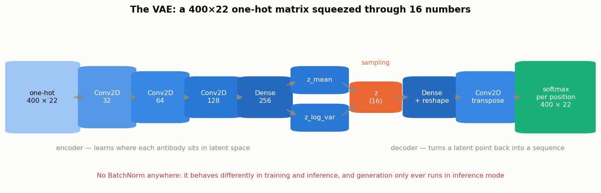
  <p>The variational autoencoder, with the shape of the data at each stage</p>
</div>

```python
# Encoder : compress 250 x 22 down to 16 numbers
encoder_inputs = keras.Input(shape=(vector_size, alphabet_size, 1))
x = layers.Conv2D(32, 3, activation="relu", strides=2, padding="same")(encoder_inputs)
x = layers.Conv2D(64, 3, activation="relu", strides=2, padding="same")(x)
x = layers.Conv2D(128, 3, activation="relu", strides=2, padding="same")(x)
x = layers.Flatten()(x)
x = layers.Dense(256, activation="relu")(x)
z_mean = layers.Dense(latent_dim, name="z_mean")(x)
z_log_var = layers.Dense(latent_dim, name="z_log_var")(x)
z = SamplingLayer()([z_mean, z_log_var])

# Decoder : rebuild 250 x 22 from those 16 numbers
inputs = keras.Input(shape=(latent_dim,))
x = layers.Dense(vector_size // 2 * alphabet_size // 2 * 64, activation="relu")(inputs)
x = layers.Reshape((vector_size // 2, alphabet_size // 2, 64))(x)
x = layers.Conv2DTranspose(64, 3, strides=1, padding="same", activation="relu")(x)
x = layers.Conv2DTranspose(64, 3, strides=2, padding="same", activation="relu")(x)
logits = layers.Conv2DTranspose(1, 3, padding="same")(x)
outputs = layers.Softmax(axis=2)(logits)
```

Two choices in that code deserve justification.

**The output is a softmax along the alphabet axis.** A position in a protein is *one* amino acid among 22, so its reconstruction should be a probability distribution over those 22 possibilities, summing to 1. An independent sigmoid per cell would instead model 22 separate yes/no decisions, which is not what a residue is. The reconstruction loss matching a softmax is a **categorical cross-entropy**, summed along the sequence.

**There is no BatchNormalization anywhere.** This is a trap worth flagging. Batch normalisation behaves differently during training (it uses the statistics of the current batch) and during inference (it uses accumulated running averages). Generation only ever runs in inference mode. A VAE with batch normalisation in its decoder can therefore train to an excellent reconstruction score and still emit garbage when you actually sample from it — the training metrics never observe the mode in which the model will be used.

### How many latent dimensions?

The latent space needs room. With only 2 dimensions, the decoder can trace just a 2-dimensional surface through sequence space, and everything it produces lies on that one small sheet. Let's compare 60 candidates drawn from a 2-dimensional latent space with 60 drawn from a 16-dimensional one.

<div style="text-align: center;">
  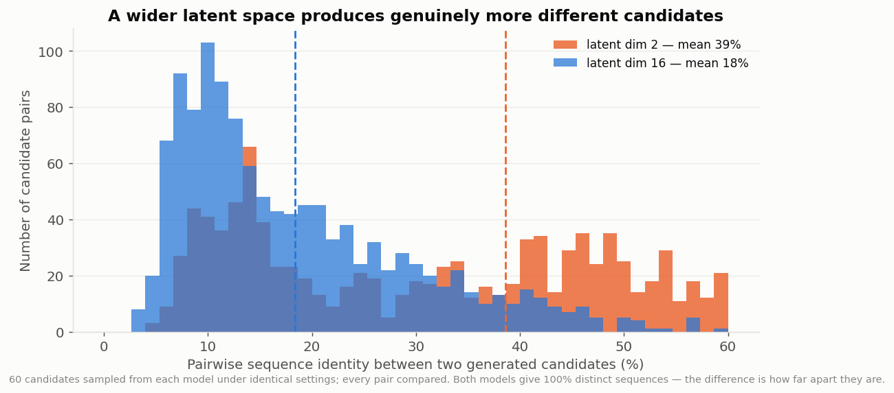
  <p>Pairwise identity between generated candidates, for two latent space sizes</p>
</div>

Both versions return 100% *distinct* sequences, so a naive count teaches us nothing. The **pairwise identity** does: with 2 dimensions, candidates share 39% of their residues on average, with a long tail of near-twins out to 60% identity. With 16 dimensions this drops to 18%, and the tail disappears. The sequences are not merely different — they are genuinely far apart.

### What does the latent space learn?

Once trained, we can encode every real antibody and look at where they land. Projecting those 16 dimensions down to 2 with a PCA gives us a map.

<div style="text-align: center;">
  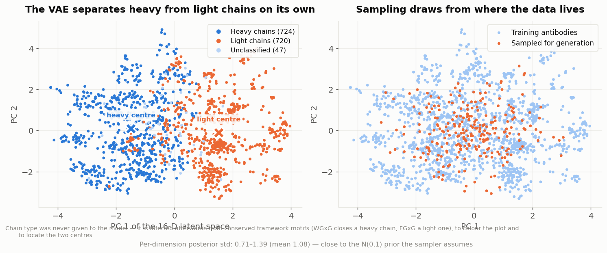
  <p>Training antibodies in latent space, coloured by chain type</p>
</div>

This is my favourite result of the whole project, and it was not planned. Colouring each point by whether it is a **heavy** or a **light** chain — information the VAE was *never given*, recovered afterwards from the conserved FR4 motif purely to paint the figure — shows the two families falling cleanly on either side of the first principal component.

The model was shown nothing but one-hot sequences. It nevertheless organised its internal representation around the most fundamental division in antibody biology, simply because that division is the strongest statistical structure in the data. This is the generative equivalent of the convolution filters in the first article learning to detect a TATA box without being told it exists.

### Asking for one family or the other

That separation is not just a pretty picture — it is a handle.

Because each family occupies its own region, we can record the **centre of each one** and sample around it instead of around the whole posterior. Nothing about the model changes; we simply draw from a different part of the space:

```python
# recorded once, from the trained encoder
stats["by_chain_type"] = {
    "heavy": {"mean": [...], "std": [...], "n_samples": 724},
    "light": {"mean": [...], "std": [...], "n_samples": 720},
}

# then, at sampling time
z = mean_family + temperature * std_family * np.random.normal(size=(n, latent_dim))
```

<div style="text-align: center;">
  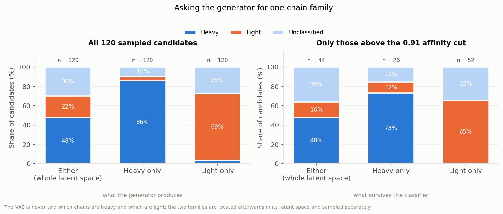
  <p>What you ask for, and what you get: 120 candidates per mode</p>
</div>

It works. Sampling the whole space returns a mixture — 48% heavy, 22% light, and 30% that carry no clear framework signature at all. Asking for heavy chains raises them to **86%**; asking for light chains raises those to **69%**.

Two caveats, both worth stating. The "unclassified" slice never disappears: those are decodes that never reproduced a recognisable end to the variable domain, and the model finishes a chain markedly less reliably than it starts one. And the proportions shift again after the interaction classifier has its say — the right-hand panel — because the filter has its own preferences, which have nothing to do with chain type. Of 120 candidates sampled for each family, 26 heavy survived the affinity cut against 52 light.

There is a deeper point here about unsupervised models. We never labelled a single chain for the generator. The structure was already in its latent space, put there by nothing but the statistics of the sequences; all we did was go and find it afterwards, and give it a name.

---


## A Judge: the Siamese Network

Our second network answers a different question: given an antibody **and** an antigen, will they interact?

The difficulty is that the answer depends on the *relationship* between two sequences, not on either one alone. We therefore need an architecture capable of comparing. This is exactly what a **Siamese network** is for.

The idea is elegant. We build **one** tower of layers, and we pass both sequences through that *same* tower — the same weights, literally the same layers. Each sequence comes out as a vector, an embedding. Because both were produced by identical machinery, the two embeddings live in the same space and can be compared meaningfully. A small head then examines that comparison and decides.

<div style="text-align: center;">
  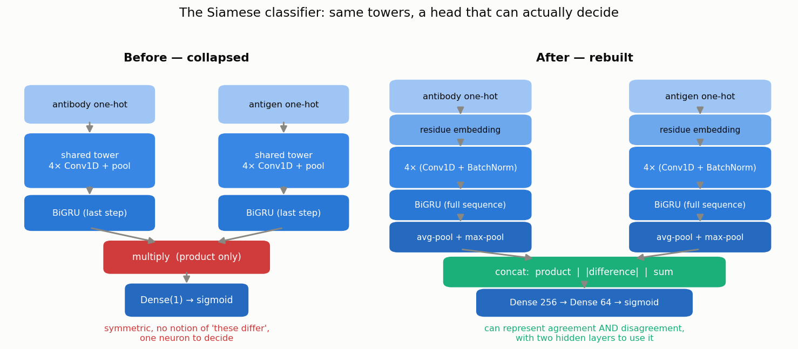
  <p>The interaction classifier : one shared tower, applied twice</p>
</div>

```python
def siamese_propagation(self, x):
    x = self.embed(x)                                  # learned residue embedding

    x = self.act(self.bn01(self.conv01(x)))            # Conv1D + BatchNorm + ReLU
    x = self.mp1(x)                                    # MaxPooling
    x = self.act(self.bn02(self.conv02(x)))
    x = self.mp2(x)
    x = self.act(self.bn03(self.conv03(x)))
    x = self.mp3(x)
    x = self.act(self.bn04(self.conv04(x)))
    x = self.mp4(x)

    x_gru = self.gru(x)                                # bidirectional GRU
    return layers.concatenate([self.gap(x_gru), self.gmp(x_gru)])
```

The tower combines the two families of layer we have met so far: **convolutions**, which detect local motifs wherever they occur, and a **recurrent layer** (a bidirectional GRU), which reads the resulting sequence of motifs in order and in both directions. Convolution finds the words; the GRU reads the sentence.

Then comes the step that decides whether the whole thing works — how to **compare** the two embeddings:

```python
merge = layers.concatenate([
    layers.multiply([left, right]),      # agreement
    layers.subtract([left, right]),      # disagreement
    layers.add([left, right]),           # joint magnitude
])
merge = self.head_norm(merge)
merge = self.head_drop1(self.head_dense1(merge))   # 256 units
merge = self.head_drop2(self.head_dense2(merge))   # 64 units
return self.head_out(merge)                        # sigmoid
```

It is tempting to simply multiply the two embeddings element by element and be done with it. That turns out to be a poor choice, for a reason worth internalising: a **product can only express agreement**. It is large where both vectors are large, and it has no way of saying *"these two differ in this respect"*. It is also symmetric — `f(a, b)` and `f(b, a)` return the same answer — so the network cannot distinguish an (antibody, antigen) pair from the reversed pairing.

Giving the head the product, the **absolute difference** and the **sum** lets it reason about similarity and dissimilarity at once, and two hidden layers give it room to do something with that.

---

## Preparing the datasets, carefully

Remember the detail noticed earlier: one antibody appears in many pairs. A random split would scatter copies of the same antibody across training and test. We therefore use a **group-aware split**, where the group is the antibody sequence itself:

```python
from sklearn.model_selection import GroupShuffleSplit

splitter = GroupShuffleSplit(n_splits=1, test_size=0.2, random_state=seed)
train_idx, test_idx = next(splitter.split(x_ab, y, groups=groups))  # groups = antibody sequence
```

No antibody in the test set appears anywhere in training. This makes our reported scores **worse**, and makes them mean something: it is the honest estimate of how the judge will behave on sequences our generator invents, which by construction belong to no split at all.

We balance the classes as announced, keeping every positive pair and sampling an equal number of negatives:

```python
n_negative = min(int(n_interaction * negative_ratio), len(data_non_interaction))
data_non_interaction_selected = data_non_interaction.sample(
    n_negative, replace=False, random_state=random_state
)
```

The `random_state` is not decoration. Without it the draw differs on every run, the split cannot be reproduced, and any later attempt to re-derive "the test set" will silently mix in pairs the model trained on. I made exactly that mistake, and briefly measured an AUC of 0.84 where the truth was 0.71. **Seed every random draw that defines a split.**

---

## Training, and choosing what to watch

For a two-class problem like ours the cost function is again the **binary cross-entropy** met in the first article. The more interesting question is which *metric* to follow during training.

**Accuracy will not do.** On a balanced two-class problem, a model that has learned nothing scores about 0.50 — and so does a model that has learned a little. Accuracy cannot distinguish "learning slowly" from "not learning at all", which is precisely when you most need to know.

Three better options, all of which we track:

- **ROC AUC**: the probability that a randomly chosen positive pair scores above a randomly chosen negative one. It requires no threshold, so a model collapsed to a constant output reads 0.50 and gives itself away immediately.
- **F1**: the harmonic mean of precision and recall, useful when the positive class is what you care about.
- **MCC**, the **Matthews correlation coefficient**: a balanced summary of the entire confusion matrix, ranging from −1 (perfectly wrong) through 0 (chance) to +1 (perfect).

$$
MCC = \frac{TP \times TN - FP \times FN}{\sqrt{(TP+FP)(TP+FN)(TN+FP)(TN+FN)}}
$$

### A trap worth its own paragraph

Here is a mistake that cost me an evening, and that will catch anyone passing a custom metric to Keras.

Hand Keras a plain function as a metric, and it calls that function **once per batch, then averages the results**. For accuracy or loss this is perfectly fine — they genuinely are averages over samples. For MCC it is wrong, because MCC is a **ratio of sums** over the confusion matrix, and the mean of per-batch ratios is not the ratio computed over the whole dataset. Measured on identical predictions:

```
global MCC (correct)      +0.2895     F1 0.4855
batch-averaged, bs = 64   +0.0028     F1 0.1804
```

A perfectly reasonable model was reporting an MCC of 0.003 and looking like a total failure. The fix is to accumulate the four confusion counts as metric **state**, and divide once, at the end of the epoch:

```python
class ConfusionMetric(keras.metrics.Metric):
    def update_state(self, y_true, y_pred, sample_weight=None):
        pos_pred = ops.cast(y_pred >= self.threshold, "float32")
        pos_true = ops.cast(y_true >= 0.5, "float32")
        self.tp.assign(self.tp + ops.sum(pos_true * pos_pred))
        self.fp.assign(self.fp + ops.sum((1 - pos_true) * pos_pred))
        # ... tn and fn likewise

class MCCMetric(ConfusionMetric):
    def result(self):
        num = self.tp * self.tn - self.fp * self.fn
        den = ops.sqrt((self.tp + self.fp) * (self.tp + self.fn)
                       * (self.tn + self.fp) * (self.tn + self.fn))
        return num / (den + epsilon())
```

The rule to remember: **any metric that is not a per-sample average must be stateful.** Accuracy and loss survive batch-averaging; MCC, F1, precision, recall and AUC do not.

### The training runs

<div style="text-align: center;">
  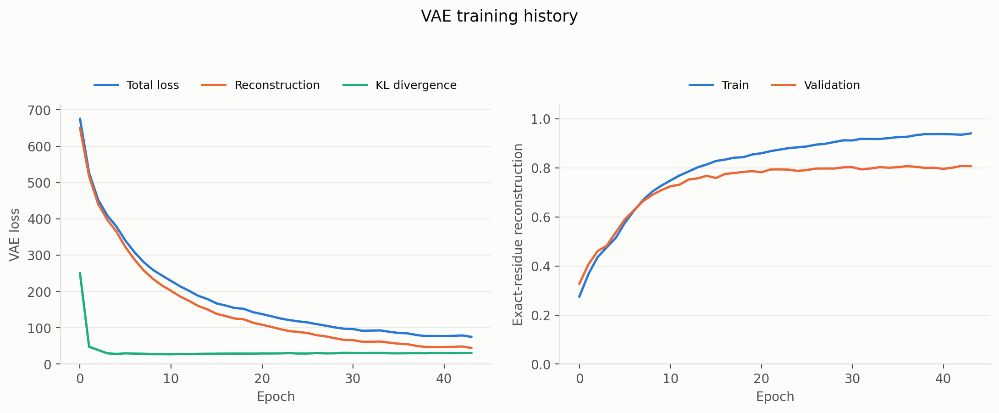
  <p>VAE training : the total loss splits into its reconstruction and KL terms</p>
</div>

On the VAE side, the loss curve shows the two terms written earlier pulling in opposite directions. We ramp the KL weight up over the first epochs rather than applying it from step 0 — otherwise the latent space collapses onto the prior before the decoder has learned to use it, and the model ends up accurate about nothing. The final model reconstructs **81% of residues exactly** on held-out chains.

<div style="text-align: center;">
  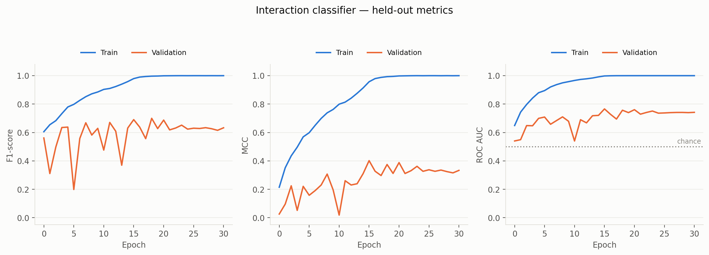
  <p>Interaction classifier : F1, MCC and AUC, training versus validation</p>
</div>

On the classifier side, the gap between training and validation curves is the honest signature of a small dataset. With 3,989 positive pairs and a few hundred thousand parameters, the network memorises its training set long before it stops improving on held-out antibodies. Early stopping keeps the best epoch and discards the rest.

### Choosing the window and the balance by experiment

We left two hyperparameters open: the **encoding window**, and the **negatives-to-positives ratio**. Rather than argue about them, let's train a handful of models and measure.

<div style="text-align: center;">
  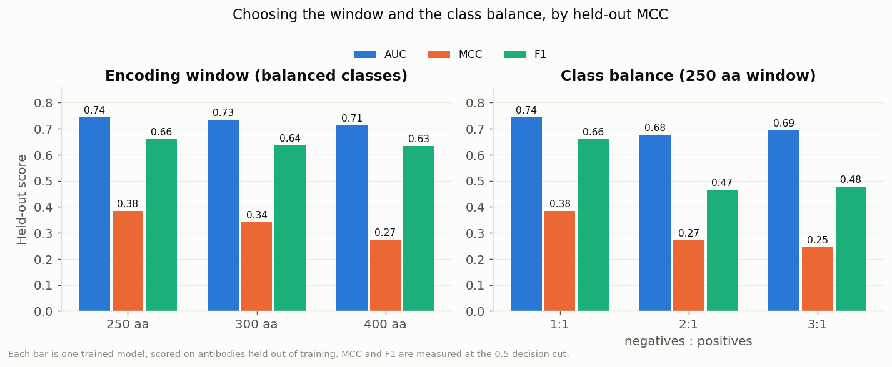
  <p>Five trained models, each evaluated on antibodies held out of its own training</p>
</div>

(These five are deliberately short runs — just long enough to rank the options against one another. The final model, trained on the winning configuration for as long as early stopping allows, scores a little higher than its counterpart here.)

Both of my intuitions turned out to be wrong, which is exactly why the experiment was worth running.

**A wider window is not better.** The 400-residue window preserves the most antigen sequence, and yields the *worst* model of the three. The reason is padding: a 218-residue antibody stretched into a 400-wide tensor is **47% zeros**, and the convolution filters spend much of their capacity on emptiness. At 250 residues we still keep 97% of antibody chains intact, with far less dead space.

**More data is not better either.** Training against three negatives per positive — four times as many pairs — drops the MCC from 0.38 to 0.25. With balanced classes, the 0.5 decision boundary naturally sits where the two classes separate, and MCC and F1, both defined at a threshold, reward that. Leaving 800,000 negatives unused feels wasteful, and is nevertheless the better choice here.

Our final configuration: a **250-residue window, with balanced classes**.

---

## Generating Candidates

Everything is in place. Sampling a candidate now takes a handful of lines: draw a latent vector, decode it, re-encode the result, and score it against our target antigen.

```python
VECTOR_SIZE = 250
models = load_models(VECTOR_SIZE)          # the trained VAE and classifier
encoder = ProteinOneHotEncoder()

antigen = "KVFGRCELAAAMKRHGLANYRGYSLGNWVCAAKFESNFNTQATNRNTDGSTDYGILQINSRWWC..."
onehot_antigen = encoder.encode(pd.Series([antigen]), VECTOR_SIZE)

for sequence, onehot, z, confidence in generate_antibody_sequence(
    n=10, vae_model=models["vae_full"].vae, encoder=encoder,
    vector_size=VECTOR_SIZE, temperature=1.0,
    chain_type="heavy",          # or "light", or None for a mixture
):
    passed, score = test_interaction(onehot, onehot_antigen, models["siamese"],
                                     threshold=0.91)
    if passed:
        print(f"{score:.3f}  {sequence}")
```

Our target for this run is **hen egg-white lysozyme**, the classic model antigen of structural immunology (and the antigen of PDB entry 1A2Y).

A subtlety hides in the re-encoding step. Read position by position, the decoder's output spells its padding out explicitly as the letter `X`. But our classifier was trained on sequences padded with **rows of zeros**, as we noted when building the encoder. Handing it an `X`-padded sequence presents it with something unlike anything seen in training — and it responds, quite reasonably, by scoring every candidate at 0.000. Stripping the placeholders before encoding is a one-line fix, and an excellent reminder that two halves of a pipeline must agree on their conventions.

```python
def strip_padding(sequence: str) -> str:
    """Drop the alphabet's placeholder letters ('X' padding, 'U') from a decode."""
    return sequence.replace("X", "").replace("U", "")
```

### How good is the judge?

<div style="text-align: center;">
  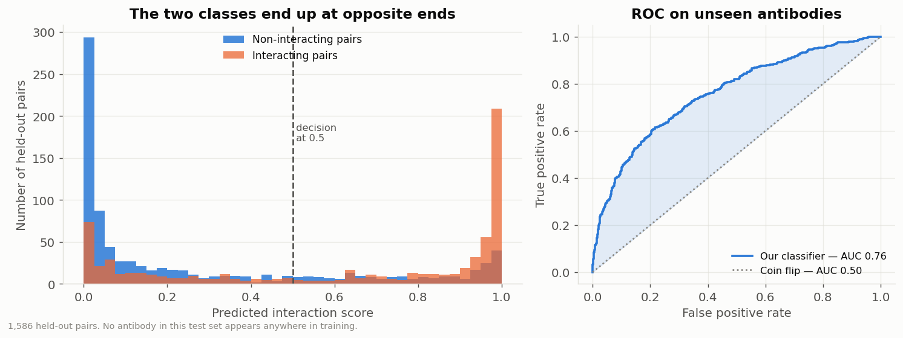
  <p>Score distribution by true class, and the corresponding ROC curve</p>
</div>

On 1,586 held-out pairs containing no antibody seen during training, the classifier reaches an **AUC of 0.76**, an **MCC of +0.38** and an **F1 of 0.65** at the 0.5 cut (precision 0.67, recall 0.63). The score distribution shows concretely what that looks like: the two classes pile up at opposite ends, with a sizeable muddle in the middle.

This is a useful filter, and nothing more. We'll return shortly to what it is not.

### Where should the threshold go?

<div style="text-align: center;">
  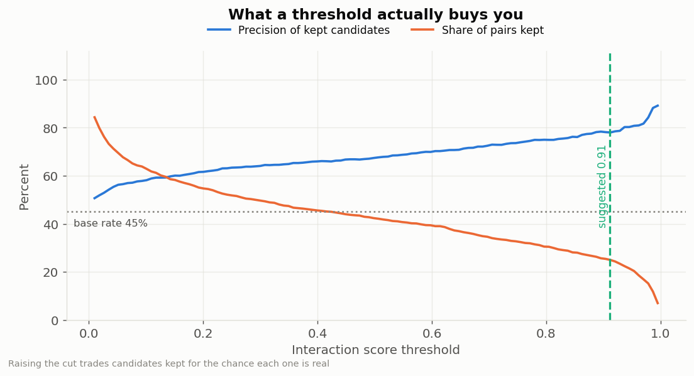
  <p>Precision of kept candidates, and share of pairs kept, as the threshold moves</p>
</div>

Raising the decision threshold trades quantity for quality, and this curve gives us the exchange rate. At 0.91 we keep a quarter of the pairs with a precision of 78%, against a base rate of 45% on this balanced test set.

One subtlety here. Pushing the threshold higher keeps buying precision on held-out pairs — 88% if we keep only the top decile, at a cut of 0.99 — so why not take it? Because that figure is measured on *held-out real pairs*, and generated candidates are a different distribution: they are novel antibodies, and the classifier scores them a little lower. Measured on this model, asking for 20 candidates at a cut of 0.99 costs 17 sampling batches; at 0.91 the same request is satisfied in 5. Three times the sampling for a dozen points of precision. With a weaker classifier the same strict rule had starved generation completely. **An operating point calibrated on one distribution does not automatically transfer to another**, so it is worth checking what a threshold costs on the distribution you will actually use it on.

### The results

<div style="text-align: center;">
  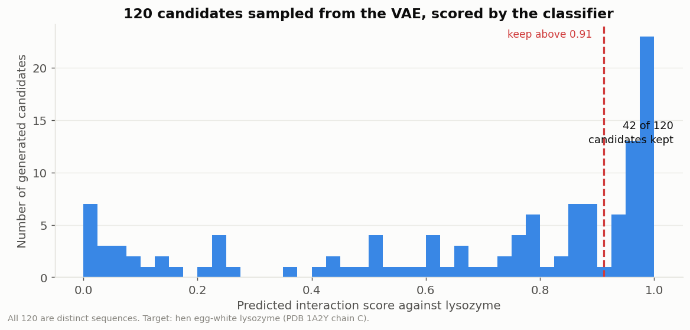
  <p>120 candidates sampled from the VAE and scored against lysozyme</p>
</div>

Of 120 sampled candidates, all 120 are distinct sequences, and 42 clear our threshold. Here are the best:

```
0.995  len=209  QIVLTQSPALMSVSLGERLTITCSVSGSVSTSIYSFWQQYEEPGRRPGLIGIYNDDNLESPAPSSFSLSG
0.989  len=214  DILMVQSQKSGTGSVGDKVSITCKSSQFLFYSVIGRNHWAYQQPGPGKSPKLNIYWNKRDEVDERDRFTG
0.985  len=231  EVQVVQLGSGLVQAGGSRRLSCASSAFGISNDDMWYVQKPPGKGLLLLSSASSLGSNVPSRYSVSGGGTI
0.959  len=120  RQQVLLTEGRGVEAVRGKRTTIICCASSSSSTASTYNYYAQWKGKVLKAAKASLLSKEPYEDSVGGRFTI
```

These deserve to be read with an immunologist's eye, because they are more than plausible-looking strings of letters.

The first two are **light-chain variable domains**. `QIVLTQSPALMSVSLGERLTITC` reproduces the canonical opening of a light chain almost motif for motif — the `LTQSPA` of framework 1, the `TITC` that closes it, and the cysteine that forms the domain's internal disulfide bridge, all at the right distance from the start.

The third is unmistakably a **heavy chain**: `EVQVVQLGSGLVQAGGSRRLSCASS` against the textbook IGHV3 opening `EVQLVESGGGLVQPGGSLRLSCAAS`. The spacing is exact and the conserved `LSC` motif with its cysteine lands precisely where it belongs.

The model produces both chain types, and places the conserved anchors correctly while filling the stretches between them with novel sequence. Nobody ever told it that frameworks and CDRs are different things.

### Are the variable parts variable in the right places?

One final check. If the generator has really learned the framework/CDR organisation, then the *positions* at which its candidates disagree with one another should match the positions at which real antibodies disagree with one another.

<div style="text-align: center;">
  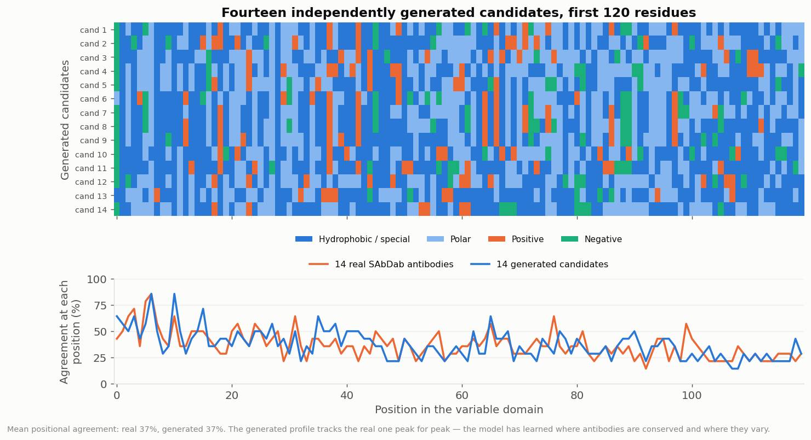
  <p>Fourteen generated candidates, with positional agreement compared against real antibodies</p>
</div>

The lower panel overlays the two conservation profiles, and they track each other peak for peak. Mean positional agreement is 37% for a random sample of real SAbDab chains, and 37% for our candidates. The generator has learned not merely the vocabulary of antibodies, but **where they are allowed to vary** — which is, in the end, what makes an antibody an antibody.

---

## What This Is Not

Now the honest part, and please read this section before quoting any number above.

**This is a toy.** It is an evening project, built to see whether the idea could be made to hold together, and the answer is "yes, just about". It is not a method for designing antibodies, and the gap between it and the real thing is enormous.

**Our judge is weak.** An AUC of 0.76 means the classifier is a *filter*, not an oracle. A score of 0.99 means this candidate ranks highly, not that it will bind. The binding constraint is data: 3,989 interacting pairs spread over 1,406 antibodies is a very small training set by any modern standard, and no architectural change manufactures more of it.

**We never look at structure.** Binding is a three-dimensional phenomenon — shape complementarity, buried surface area, electrostatics, solvation. We have worked entirely from sequence, which discards all of it. Two sequences can be neighbours in one-hot space and fold into completely different shapes.

**We ignore everything that makes an antibody usable.** Real candidates must be stable, soluble, expressible, non-aggregating, non-immunogenic, and free of liabilities such as unpaired cysteines or deamidation sites. A sequence scoring well here could easily be impossible to manufacture.

**And the field has moved well beyond this.** If the real thing interests you, the modern toolkit looks nothing like our two small networks:

- **Antibody-specific language models** — AbLang, AntiBERTy, IgLM — trained on hundreds of millions of antibody sequences from repertoire sequencing, which learn the grammar of immunoglobulins far better than 1,491 chains ever could.
- **General protein language models** such as the ESM family, which transfer knowledge across the entire protein universe.
- **Structure-based design**: RFdiffusion generating backbones directly in three dimensions, ProteinMPNN choosing sequences to fit them, AlphaFold-Multimer or AlphaFold 3 predicting the complex to verify the design.
- And at every stage, **experimental validation**, because no model is trusted on its own.

So why build this at all? Because assembling the small version yourself is how the big versions stop being magic. Every difficulty we hit — the latent space needing room, the metric that lied, the two halves disagreeing about padding, the operating point that refused to transfer — is a real difficulty, and it scales up unchanged. The models grow larger; the failure modes stay remarkably similar.

---

## Conclusion

We set out to invent proteins that never existed, and we have: a variational autoencoder producing credible immunoglobulin chains, complete with correct frameworks and hypervariable loops in the right places, paired with a Siamese classifier filtering them against a chosen antigen with modest but real discrimination.

Along the way we saw the two network families from the previous articles doing new work — convolutions compressing a sequence into a latent code and expanding it back, a recurrent layer reading motifs in order — plus two ideas new to this article: a **latent space** you can sample from, and a **shared tower** that compares two objects rather than labelling one.

The biology was not decoration. It told us how long our window should be, explained why antibodies are rich in glycine and serine, warned us that one antibody appears in many pairs, and ultimately gave us the means to check the output: we could tell that a generated sequence was an IGHV1 heavy chain because immunology says what one looks like. A model that has learned a conserved framework and variable CDRs has learned something true about the immune system, and we can verify that claim without setting foot in a laboratory.

And it remains a draft. The point was never to compete with RFdiffusion; it was to find out what actually happens when you ask a small network to make something new, and to be able to tell whether what came out was any good.

The complete code is available on the repo: [https://github.com/sebgra/intelligent_antibodies](https://github.com/sebgra/intelligent_antibodies)

---

## To Go Further

On generative models:

- The original VAE paper, *Auto-Encoding Variational Bayes* (Kingma & Welling, 2013): [https://arxiv.org/abs/1312.6114](https://arxiv.org/abs/1312.6114)
- An accessible introduction to variational autoencoders: [https://towardsdatascience.com/understanding-variational-autoencoders-vaes-f70510919f73](https://towardsdatascience.com/understanding-variational-autoencoders-vaes-f70510919f73)
- Siamese networks and metric learning: [https://keras.io/examples/vision/siamese_network/](https://keras.io/examples/vision/siamese_network/)

On antibodies and their computational design:

- **SAbDab**, the database used throughout: [https://opig.stats.ox.ac.uk/webapps/sabdab/](https://opig.stats.ox.ac.uk/webapps/sabdab/)
- **AbLang**, an antibody-specific language model: [https://github.com/oxpig/AbLang](https://github.com/oxpig/AbLang)
- **ESMFold / ESM Atlas**, to predict a structure from a single sequence: [https://esmatlas.com/](https://esmatlas.com/)
- **RFdiffusion**, to generate protein backbones directly in three dimensions: [https://github.com/RosettaCommons/RFdiffusion](https://github.com/RosettaCommons/RFdiffusion)
- A review of machine learning applied to antibody engineering: [https://www.nature.com/articles/s41587-021-01120-1](https://www.nature.com/articles/s41587-021-01120-1)
